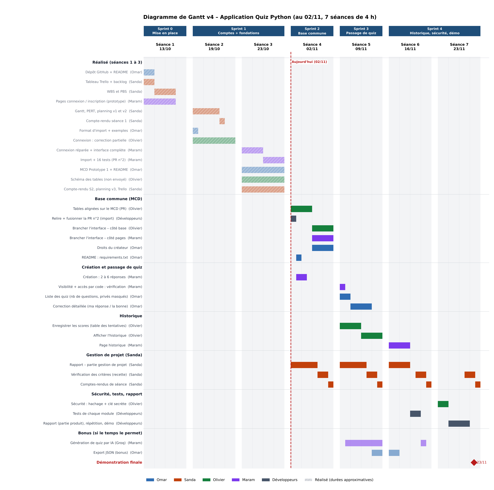
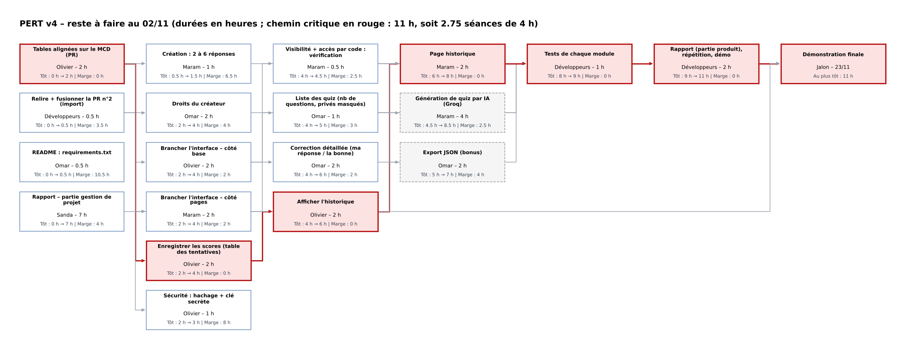

# Planning des sprints – Application Quiz Python

**Groupe 4 – PROJ531** · Version 4 du 02/11/2026 (début de la séance 4) · Basée sur le grand bilan du PO (02/11)

## Pourquoi une version 4

D'après le grand bilan du projet (parties 7 et 10) :

- **L'interface est en avance** : inscription, connexion, création de quiz, quiz privés, minuteur, passage et score fonctionnent. Mais ils tournent sur une **table de test**.
- **La base de données a environ une séance de retard** : les tables alignées sur le MCD ne sont pas sur le dépôt, et l'import (PR n°2) n'est pas fusionné.
- **Rien n'a été envoyé pendant les vacances** (23/10 – 02/11).

La version 4 reprend le découpage du bilan (partie 10) et place chaque tâche restante selon les dépendances et la disponibilité de chacun. Les durées sont des **heures restantes estimées**. Dans Trello, on garde les temps estimés d'origine pour la comparaison prévu / réel du rapport.

## Hypothèses

- Séances restantes : 02/11, 09/11, 16/11 et 23/11, de 4 h chacune. Pas de travail hors séance.
- Développement : Omar, Olivier, Maram. Sanda (Scrum Master) : vérification des critères (1 h par séance), comptes-rendus, partie gestion de projet du rapport.
- Démonstration le 23/11.

## Vue d'ensemble

| Sprint | Séance(s) | Objectif | Livré en fin de sprint |
|---|---|---|---|
| Sprint 0 | 13/10 | Mise en place | Dépôt, Trello, WBS/PBS, prototype ✅ |
| Sprint 1 | 19/10 – 23/10 | Comptes + fondations | Connexion réparée, interface complète, MCD Prototype 1, import (PR n°2) ✅ |
| **Sprint 2** | **02/11** | **Base commune** | Tables alignées sur le MCD, PR n°2 fusionnée, droits du créateur, branchement de l'interface |
| **Sprint 3** | **09/11** | **Passage de quiz** | Liste des quiz, correction détaillée, enregistrement des scores, affichage de l'historique |
| **Sprint 4** | **16/11 – 23/11** | **Historique, sécurité, démo** | Page historique, tests, sécurité, rapport, répétition et démonstration |

## Diagrammes

## Chemin critique (PERT)

**Tables alignées sur le MCD → Enregistrer les scores → Afficher l'historique → Page historique → Tests → Rapport + démo**

Cela fait 11 h de travail, soit environ 3 séances, et il en reste 4. **Tout dépend des tables d'Olivier aujourd'hui** : si elles ne sont pas fusionnées le 02/11, l'historique, les droits du créateur et le branchement glissent tous d'une séance, et la marge du 23/11 disparaît.

## Détail séance par séance

### Sprint 2 – Séance 4 – 02/11
| Membre | Travail prévu |
|---|---|
| Olivier | **Tables alignées sur le MCD**, sur une nouvelle branche partie de `main` (2 h) ; branchement de l'interface, côté base (2 h) |
| Omar | Relecture et fusion de la PR n°2 avec Maram (0,5 h) ; `requirements.txt` (0,5 h) ; droits du créateur (2 h) ; 1 h libre : relire la PR des tables d'Olivier |
| Maram | Relecture et fusion de la PR n°2 (0,5 h) ; formulaire de création : 2 à 6 réponses (1 h) ; branchement de l'interface, côté pages (2 h) |
| Sanda | Rapport partie gestion de projet (2,5 h) ; vérification des critères (1 h) ; compte-rendu (0,5 h) |

### Sprint 3 – Séance 5 – 09/11
| Membre | Travail prévu |
|---|---|
| Olivier | Enregistrer les scores, table des tentatives (2 h) ; afficher l'historique (2 h) |
| Omar | Liste des quiz : nombre de questions, quiz privés masqués (1 h) ; correction détaillée, ma réponse et la bonne (2 h) ; export JSON – bonus (1 h) |
| Maram | Vérification de la visibilité et de l'accès par code (0,5 h) ; **génération par IA – bonus** (3,5 h) |
| Sanda | Rapport partie gestion de projet (2,5 h) ; vérification des critères (1 h) ; compte-rendu (0,5 h) |

### Sprint 4 – Séances 6 et 7 – 16/11 et 23/11
| Membre | 16/11 | 23/11 |
|---|---|---|
| Olivier | Tests (1 h) ; 3 h libres : aide sur la page historique, ou **sécurité avancée au 16/11** | Sécurité : hachage + clé secrète (1 h) ; rapport, répétition, démo (2 h) |
| Omar | Fin de l'export JSON (1 h) ; tests (1 h) ; 2 h libres | Rapport, répétition, démo (2 h) ; marge |
| Maram | Page historique (2 h) ; tests (1 h) ; fin de la génération par IA (0,5 h) | Rapport, répétition, démo (2 h) ; marge |
| Sanda | Fin du rapport partie gestion de projet (2 h) ; vérification finale (1 h) ; compte-rendu (0,5 h) | Dernier compte-rendu, relecture du rapport |

## Points d'attention

1. **Tables d'Olivier = priorité absolue aujourd'hui.** Son schéma est sur Discord : il faut l'envoyer sur une branche, avec une PR relue (par Omar) et fusionnée avant la fin de la séance.
2. **Ne pas fusionner la PR n°1** (`SinisterOlivier-patch-1`) telle quelle : sa branche part de la version du 19/10, et la fusionner supprimerait le travail ajouté depuis. Il faut repartir de `main`.
3. **La génération par IA est un bonus.** Elle est placée sur le temps libre de Maram au 09/11, pendant qu'Olivier fait l'historique : elle ne retarde donc pas le cœur du produit. Mais si le branchement prend du retard, Maram aide d'abord au branchement. Il faut aussi prévoir un plan B sans internet pour la démo.
4. **Sécurité** : prévue le 23/11 selon le bilan. Olivier a 3 h libres le 16/11 : la faire ce jour-là réduirait le risque le jour de la démo.
5. **Temps réels** : chacun complète ses cartes à la fin de chaque séance. Ils sont indispensables pour la partie prévu / réel du rapport.
