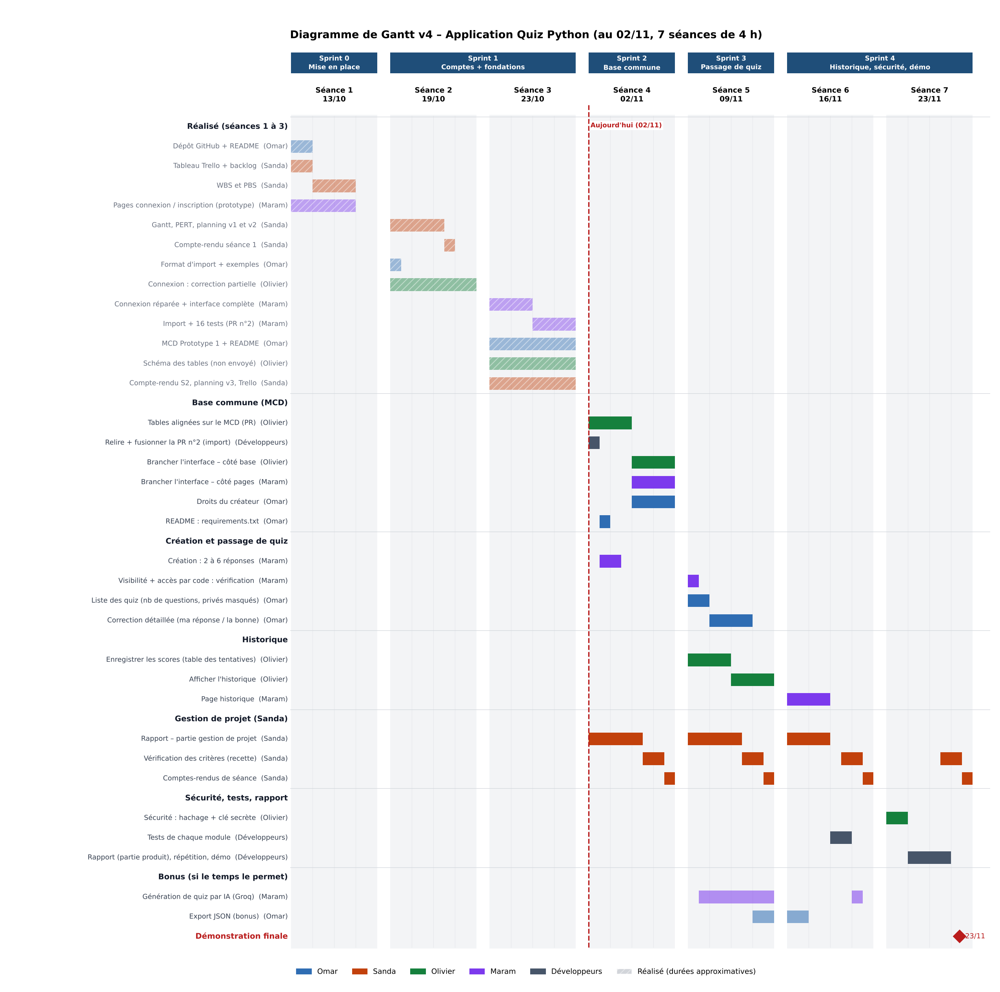
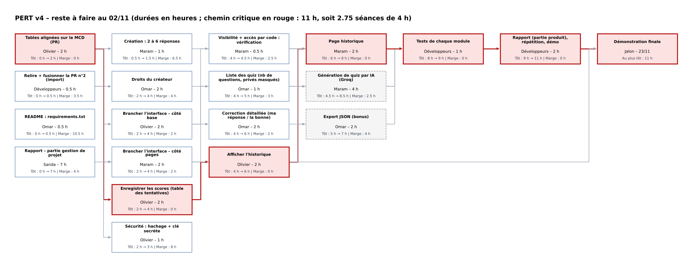

# Planning des sprints – Application Quiz Python

**Groupe 4 – PROJ531** · Version 6 du 09/11/2026 (séance 5) · Basée sur le point PO du 09/11 et ses décisions de 16 h

## Pourquoi une version 6

D'après le point du PO du 09/11 :

- **La séance 4 n'était pas terminée** : 5 Pull Requests ouvertes et aucune fusionnée. Les tables d'Olivier avaient été envoyées directement sur `main`, qui restait cassé (accueil en erreur, quiz créés sans questions, accès par code impossible). La PR n°5 de Maram, fusionnée le 09/11 à 14h22, a réparé `main`.
- **Priorité du PO : terminer d'abord la séance 4**, puis passer aux scores et à l'historique.
- **L'import (PR n°2) est écrit pour l'ancienne table** et doit être adapté avant d'être fusionné.
- **Décision du PO (09/11, 16 h) : la génération par IA devient obligatoire.** L'export JSON (bonus) est abandonné, Omar prend la page historique le 16/11, et Maram fait la génération par IA ce jour-là, avec un plan B sans internet pour la démo.

Les durées sont des **heures restantes estimées**. Dans Trello, on garde les temps estimés d'origine pour la comparaison prévu / réel.

## Hypothèses

- Temps restant : 3 h le 09/11 (après la fusion de la PR n°5), puis 4 h le 16/11 et 4 h le 23/11. Pas de travail hors séance.
- Développement : Omar, Olivier, Maram. Sanda (Scrum Master) : vérification des critères, comptes-rendus, partie gestion de projet du rapport.
- Démonstration le 23/11.

## Vue d'ensemble

| Sprint | Séance(s) | Objectif | État / livré en fin de sprint |
|---|---|---|---|
| Sprint 0 | 13/10 | Mise en place | ✅ |
| Sprint 1 | 19/10 – 23/10 | Comptes + fondations | ✅ Connexion, interface, MCD |
| Sprint 2 | 02/11 | Base commune | ✅ Terminé le 09/11 avec la PR n°5 : tables, interface branchée, création de quiz |
| **Sprint 3** | **09/11** | **Fin de la base + passage de quiz** | `main` réparé, import fusionné, scores enregistrés, droits du créateur, début de l'historique et de la correction détaillée |
| **Sprint 4** | **16/11 – 23/11** | **Historique, IA, sécurité, démo** | Historique et correction détaillée terminés, **génération par IA + plan B**, clés étrangères, sécurité (16/11), tests, rapport, répétition et démonstration |

## Diagrammes

## Chemin critique (PERT)

**Enregistrer les scores → Afficher l'historique → Page historique → Tests → Rapport + démo**

C'est 9 h de travail sur les 11 h qui restent. **La priorité d'Olivier aujourd'hui est l'enregistrement des scores dans `attempts`**, sur une branche avec PR. S'il glisse, l'historique, les tests et le rapport glissent tous vers le jour de la démo.

**Conséquence de l'IA obligatoire :** les 16/11 d'Omar et de Maram sont pleins. **Les tests passent au début de la séance du 23/11**, et il ne reste qu'environ 1 h de marge par développeur avant la démo.

## Détail séance par séance

### Sprint 3 – Séance 5 – 09/11 (après la fusion de la PR n°5)
| Membre | Travail prévu |
|---|---|
| Olivier | **Enregistrer les scores dans `attempts`** (2 h) ; début de l'historique (1 h) ; fermer les PR n°1, n°3 et n°4 sans les fusionner |
| Omar | Tester `main` après la fusion ; **droits du créateur** (PR `droits-createur`, 2 h) ; relire et fusionner l'import (0,5 h) ; début de la correction détaillée (0,5 h) |
| Maram | **Adapter la PR n°2 (import) à la nouvelle base** et passer origin à « saisie » (1,5 h) ; vérifier la visibilité et l'accès par code (0,5 h) ; liste des quiz : nombre de questions, quiz privés masqués (1 h) |
| Sanda | Comptes-rendus des séances 4 et 5, Trello avec les temps réels (1,5 h) ; vérification des critères (1 h) ; rapport partie gestion de projet |

### Sprint 4 – Séances 6 et 7 – 16/11 et 23/11
| Membre | 16/11 | 23/11 |
|---|---|---|
| Olivier | Fin de l'historique (1 h) ; clés étrangères sur `attempts` et la table des documents (1 h) ; sécurité (1 h) ; **1 h libre : commencer les tests** | Tests (1 h) ; rapport, répétition, démo (2 h) ; 1 h de marge |
| Omar | Fin de la correction détaillée (1,5 h) ; **page historique** (2 h) | Tests (1 h) ; rapport, répétition, démo (2 h) ; 1 h de marge |
| Maram | **Génération par IA (Groq) + plan B sans internet** (4 h) | Tests (1 h) ; rapport, répétition, démo (2 h) ; 1 h de marge |
| Sanda | Rapport partie gestion de projet (2,5 h) ; vérification (1 h) ; compte-rendu (0,5 h) | Fin du rapport (2 h) ; vérification finale (1 h) ; dernier compte-rendu |

## Changements par rapport à la version 4 (v5 et v6)

| Changement | Raison |
|---|---|
| La fin de la séance 4 se fait le 09/11 | Aucune PR fusionnée le 02/11 (décision du PO : finir la séance 4 d'abord) |
| Nouvelle tâche : adapter la PR n°2 à la nouvelle base + origin « saisie » (1,5 h, Maram) | L'import est écrit pour l'ancienne table ; décision du PO sur origin |
| Nouvelle tâche : clés étrangères sur `attempts` et la table des documents (1 h, Olivier) | Non réalisé à la séance 4 (bilan du PO) ; placée après l'historique pour ne pas ralentir le chemin critique |
| Liste des quiz : Omar → **Maram** (validé par le PO) | Maram a construit la liste de l'accueil ; Omar a déjà les droits du créateur et la correction détaillée |
| **Génération par IA : obligatoire**, Maram le 16/11, avec un plan B sans internet | Décision du PO (09/11, 16 h) |
| **Page historique : Maram → Omar** | Libère Maram pour l'IA (décision du PO) |
| **Export JSON (bonus) abandonné** | Décision du PO ; passe en « amélioration possible » |
| Tests : du 16/11 au début du 23/11 | Conséquence de l'IA sur les 16/11 d'Omar et de Maram |

## Points d'attention

1. **Génération par IA** : 4 h pour Maram le 16/11, sans marge. Le **plan B sans internet** (la génération simulée déjà faite) doit être prêt avant la démo. Si l'IA n'est pas finie le 16/11, la démo se fait avec le plan B.
2. **Tests le jour de la démo** : seulement 1 h de marge par développeur le 23/11. Olivier peut commencer les tests le 16/11 avec son heure libre.
3. **Clé API** : dans une variable d'environnement, jamais sur GitHub.
4. **Plus aucun envoi direct sur `main`** : une branche et une PR relue pour chaque carte, validée par le PO après test.
5. **Temps réels** à compléter dans Trello en fin de séance.
