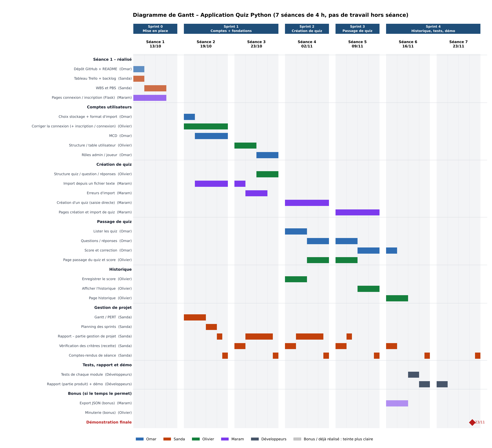
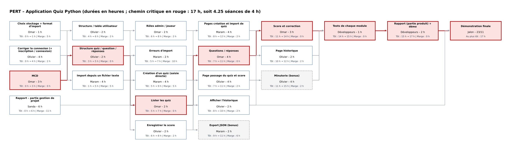

# Planning des sprints – Application Quiz Python

**Groupe 4 – PROJ531** · Version 3 du 23/10/2026 (état à 16 h, pendant la séance 3) · *À valider par le PO*

## Pourquoi une version 3

Le bilan de la séance 2 et le commit de Maram du 23/10 ont changé la situation :

- **Retards** : le MCD (premier maillon du chemin critique) et l'import de fichier n'étaient pas faits le 19/10. La correction de la connexion n'est que partielle.
- **De l'avance ailleurs** : Maram a construit un prototype qui fait déjà la création de quiz, l'affichage des questions, le calcul du score, la minuterie, les quiz privés et l'accès par code. Mais il repose sur sa propre table `quizzes` (questions en JSON), et pas sur le MCD.
- **Nouvelles cartes** : « Brancher l'interface sur la vraie base », « Sécurité : hachage + clé secrète » (sprint 4, décision du PO), « README : requirements.txt et règles du format d'import ».
- **Décisions produit** : pas de rôle admin global (droits du créateur), quiz publics / privés, suppression de compte avec une simple confirmation.

Les durées de cette version sont donc des **heures restantes**, estimées carte par carte à partir du code présent sur `main`. Dans Trello, on garde les temps estimés d'origine, pour pouvoir comparer le prévu et le réel dans le rapport.

## Hypothèses

- Séances restantes : fin de la séance 3 (23/10, 2 h), puis 02/11, 09/11, 16/11 et 23/11, de 4 h chacune. Pas de travail hors séance.
- Développement : Omar, Olivier et Maram. Sanda (Scrum Master) gère la planification, vérifie les critères (1 h par séance), rédige les comptes-rendus et la partie gestion de projet du rapport.
- La démonstration a lieu le 23/11. *À confirmer avec l'enseignant.*

## Changements par rapport à la version 2

| Changement | Raison |
|---|---|
| **Structure quiz : Olivier → Omar** | Omar fait le MCD : c'est lui qui aligne la structure dessus. Ça soulage Olivier, qui était le goulot (plein à chaque séance). |
| **Page de passage / résultat du quiz : Olivier → Omar** | La page existe déjà (prototype de Maram). Il reste la page de résultat avec la correction, qui suit directement « Score et correction » d'Omar. |
| **Accès par code : Omar → Maram** | Maram l'a déjà codé. Il reste à vérifier les critères. |
| Nouvelle carte « Brancher l'interface sur la vraie base » | 4 h : 2 h Olivier (base) + 2 h Maram (pages) |
| Nouvelle carte « Sécurité : hachage + clé secrète » | 1 h, Olivier, sprint 4 (décision du PO) |
| Nouvelle carte « README : requirements.txt + règles d'import » | 0,5 h, Omar |
| Visibilité du quiz et minuterie | Faites par Maram (prototype) ; leurs temps réels restent à renseigner |
| Export JSON (bonus) | Seulement s'il reste du temps ; la minuterie (bonus) est déjà faite |

## Vue d'ensemble

| Sprint | Séance(s) | Objectif | Livré en fin de sprint |
|---|---|---|---|
| **Sprint 0** | 13/10 | Mise en place | Dépôt, Trello, WBS/PBS, prototype de connexion ✅ |
| **Sprint 1** | 19/10 – 23/10 | Comptes + fondations | MCD, connexion corrigée (sauf hachage), README et règles d'import |
| **Sprint 2** | 02/11 | **Base commune** + création | Structure quiz alignée sur le MCD, droits du créateur, branchement côté base, import et erreurs d'import |
| **Sprint 3** | 09/11 | **Passage de quiz** | Pages branchées sur le MCD, liste des quiz, questions, score et correction, enregistrement des scores, affichage de l'historique, accès par code |
| **Sprint 4** | 16/11 – 23/11 | Historique, sécurité, tests, démo | Page historique, page de résultat, page d'import, sécurité, tests, rapport, démonstration |

## Chemin critique (PERT)

Le reste à faire a **deux chaînes critiques de 12 h** (environ 3 séances) qui partent du MCD :

- **MCD → Structure quiz → Brancher (base) → Lister les quiz → Questions → Score et correction → Tests → Rapport + démo**
- **MCD → Structure quiz → Enregistrer le score → Afficher l'historique → Page historique → Tests → Rapport + démo**

Il faut surveiller en priorité **le MCD et la structure quiz (Omar)** : tout le reste en dépend. Avec la répartition ci-dessous, tout le code est fini le **16/11**, et il reste environ **2,5 h de marge par développeur le 23/11**.

## Diagrammes

## Détail séance par séance

### Séance 3 – 23/10 (fin de séance, à partir de 16 h)
| Membre | Travail prévu |
|---|---|
| Omar | Finir le MCD (1 h) ; README : requirements.txt + règles d'import (0,5 h) ; début de la structure quiz (0,5 h) |
| Olivier | Corriger la connexion : B1, B2, B4, B5, `.gitignore` (1,5 h) ; début de la table utilisateur (0,5 h) |
| Maram | Import depuis un fichier texte (2 h), **sur une branche** |
| Sanda | Vérification des critères (1 h) ; compte-rendu (0,5 h) ; début du rapport partie B (0,5 h) |

### Sprint 2 – Séance 4 – 02/11
| Membre | Travail prévu |
|---|---|
| Omar | Fin de la structure quiz (1,5 h) ; droits du créateur (2 h) ; début de « Lister les quiz » (0,5 h) |
| Olivier | Fin de la table utilisateur (0,5 h) ; brancher l'interface, côté base (2 h) ; début de l'enregistrement du score (0,5 h) ; 1 h libre : aider sur le chemin critique |
| Maram | Fin de l'import (2 h) ; erreurs d'import (2 h) |
| Sanda | Rapport partie B (2,5 h) ; vérification des critères (1 h) ; compte-rendu (0,5 h) |

### Sprint 3 – Séance 5 – 09/11
| Membre | Travail prévu |
|---|---|
| Omar | Fin de « Lister les quiz » (0,5 h) ; questions / réponses (1 h) ; score et correction (2 h) ; début de la page de résultat (0,5 h) |
| Olivier | Enregistrer le score (1,5 h) ; afficher l'historique (2 h) ; début de la page historique (0,5 h) |
| Maram | Brancher l'interface, côté pages (2 h) ; règles de validation de la création (1 h) ; accès par code (0,5 h) ; début de la page d'import (0,5 h) |
| Sanda | Rapport partie B (2,5 h) ; vérification des critères (1 h) ; compte-rendu (0,5 h) |

### Sprint 4 – Séances 6 et 7 – 16/11 et 23/11
| Membre | 16/11 | 23/11 |
|---|---|---|
| Omar | Fin de la page de résultat (1,5 h) ; tests (1 h) ; rapport (0,5 h) ; 1 h libre | Rapport + démo (1,5 h) ; marge |
| Olivier | Fin de la page historique (1,5 h) ; sécurité (1 h) ; tests (1 h) ; rapport (0,5 h) | Rapport + démo (1,5 h) ; marge |
| Maram | Fin de la page d'import (1,5 h) ; export JSON – bonus (1 h) ; tests (1 h) ; rapport (0,5 h) | Rapport + démo (1,5 h) ; export JSON si le temps le permet ; marge |
| Sanda | Fin du rapport partie B (0,5 h) ; vérification finale (1 h) ; compte-rendu (0,5 h) ; relecture du rapport | Dernier compte-rendu ; relecture |

## Points d'attention

1. **Deux schémas de quiz en parallèle** (`quizzes` en JSON chez Maram, `quizz / questions / answers` chez Olivier). Tant que le MCD n'est pas fini et que l'interface n'est pas branchée dessus, chaque nouvelle fonctionnalité ajoute du travail de migration. **Priorité absolue : le MCD aujourd'hui.**
2. **Priorités** : les bonus et la priorité 5 ne passent qu'après l'import (priorité 3), qui n'est toujours pas sur `main`.
3. **Git** : une branche par carte et une Pull Request relue avant fusion. Le commit de 1 500 lignes du 23/10 a été poussé directement sur `main`.
4. **Critères à faire valider par le PO** : code privé de 12 caractères au lieu de 6 ; le créateur voit-il ses propres quiz privés dans la liste ?
5. **Temps réels manquants** : visibilité et minuterie (Maram), travail fait hors séance. Ils sont indispensables pour la comparaison prévu / réel du rapport.

## Mises à jour Trello à faire après validation

| Carte | Changement |
|---|---|
| Structure quiz / question / réponses | Membre → Omar |
| Page passage du quiz et score | Membre → Omar ; renommer « Page de résultat du quiz » ; sprint 4 |
| Accéder à un quiz privé par code | Sprint 3 |
| Import, Erreurs d'import, Droits du créateur, Table utilisateur | Sprint 2 |
| Lister les quiz, Création en saisie directe, Brancher l'interface, Score et correction, Enregistrer le score, Afficher l'historique | Sprint 3 |
| Pages création et import de quiz | Sprint 4 |
